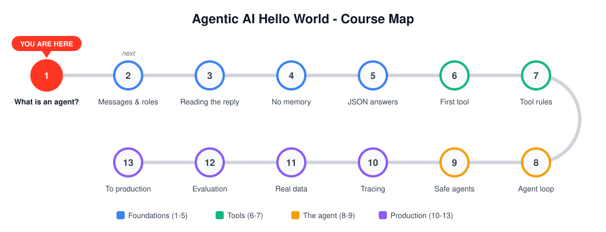
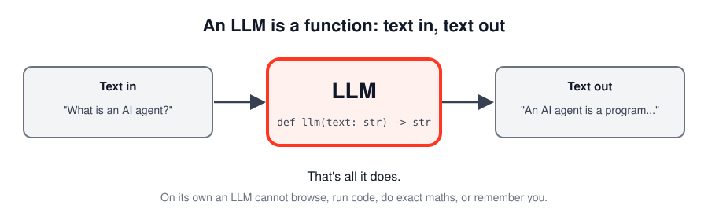

# Video 01 - What is an AI agent? + your first LLM call

**Length:** about 10 minutes | **Phase:** Foundations | **Prerequisites:** basic Python, [setup.md](../setup.md) done

## By the end of this video you can
1. Explain in one sentence the difference between an **LLM**, a **chatbot** and an **agent**.
2. Call an LLM from a Databricks notebook and print its reply.
3. Explain why an "OpenAI" client is talking to a **Llama** model hosted in **your Databricks workspace**.

## The one idea
> An LLM is a function: **text in, text out**. Everything an agent does is built on top of this one call.

## Deliberately NOT in this video
Message roles (Video 02), `choices` / `finish_reason` / temperature (Video 03), memory (Video 04). If you are curious, good - that's what's next.

## Files

| File | Use it to |
| --- | --- |
| [notebooks/01-hello-llm](notebooks/) | Code along with the video |
| [notebooks/01-hello-llm-solutions](notebooks/) | Check your exercise answers (try first!) |
| [script.md](script.md) | Read the narration or use it as a transcript |
| [exercises.md](exercises.md) | Practise after watching (about 15 minutes) |
| [quiz.md](quiz.md) | Check you got it (5 questions) |
| [cheatsheet.md](cheatsheet.md) | Keep open while coding |
| [diagrams/](diagrams/) | The three diagrams from the video |

## Diagrams in this video
1. [An LLM is a function](diagrams/01-llm-is-a-function.svg)
2. [Chatbot vs agent](diagrams/02-chatbot-vs-agent.svg)
3. [Where the request goes](diagrams/03-where-the-request-goes.svg)

## Recurring segments
* **Cost meter:** a short call uses tens to a few hundred tokens - a tiny fraction of a cent. Experiment freely.
* **What could go wrong?** The model can be **confidently wrong**. Ask it to multiply 48729 by 3817 and compare with Python - in our tests both Llama and Claude got it wrong every time, with a different answer each run. Agents fix this with tools (Videos 06-08).

## Next
[Video 02 - Talking to the model: messages and roles](../02-messages-and-roles/README.md)
