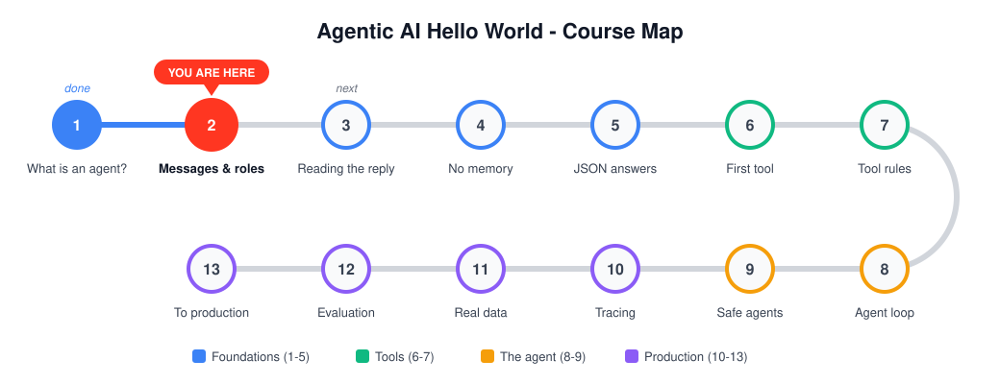
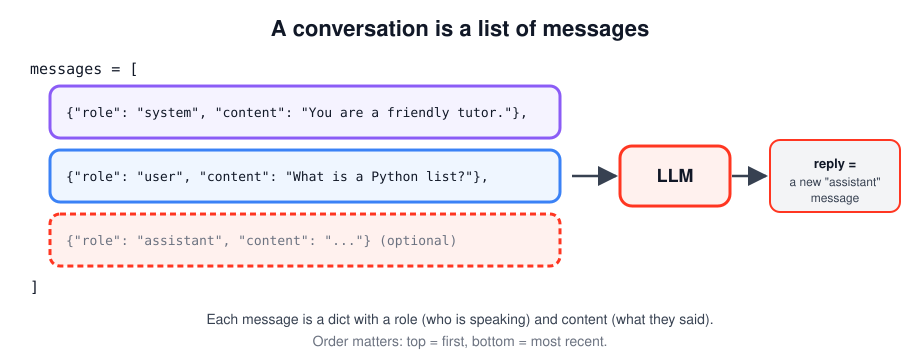

# Video 02 - Talking to the model: messages and roles

**Length:** about 10 minutes | **Phase:** Foundations | **Prerequisites:** [Video 01](../01-what-is-an-agent/README.md)

## By the end of this video you can
1. Explain what a **message** is and why a conversation is a **list** of them.
2. Use the three roles - `system`, `user`, `assistant` - and say who writes each one.
3. Change a model's behaviour with a **system prompt**.
4. Teach a model a format by writing **example answers** yourself (few-shot prompting).

## The one idea
> Every message has a **role** that tells the model **who is speaking**. You control the model by choosing what goes in each role.

## Deliberately NOT in this video
`choices`, `finish_reason`, tokens in detail, temperature (Video 03). Multi-turn memory (Video 04). The `tool` role (Video 06).

## Files

| File | Use it to |
| --- | --- |
| [notebooks/02-messages-and-roles](notebooks/) | Code along with the video |
| [notebooks/02-messages-and-roles-solutions](notebooks/) | Check your exercise answers (try first!) |
| [script.md](script.md) | Read the narration or use it as a transcript |
| [exercises.md](exercises.md) | Practise after watching (about 15 minutes) |
| [quiz.md](quiz.md) | Check you got it (5 questions) |
| [cheatsheet.md](cheatsheet.md) | Keep open while coding |
| [diagrams/](diagrams/) | The three diagrams from the video |

## Diagrams in this video
1. [Anatomy of a message](diagrams/01-anatomy-of-a-message.svg)
2. [Who writes each role](diagrams/02-who-writes-each-role.svg)
3. [Few-shot examples](diagrams/03-few-shot-examples.svg)

## Recurring segments
* **Cost meter:** the system prompt is sent with **every** call, so you pay for it every time. In our test a long system prompt raised the input from 39 to 402 tokens per call - about 10 times more.
* **What could go wrong?** A system prompt is a strong suggestion, **not a lock**. We told the model "only answer cooking questions", then the user said "ignore all previous instructions". In our tests Llama 3.3 obeyed the user 3 times out of 3; Claude Haiku refused 3 times out of 3. Real guardrails belong in your code (Video 09).

## Next
Video 03 - Reading the reply: `choices`, `finish_reason`, tokens and temperature (coming soon)
