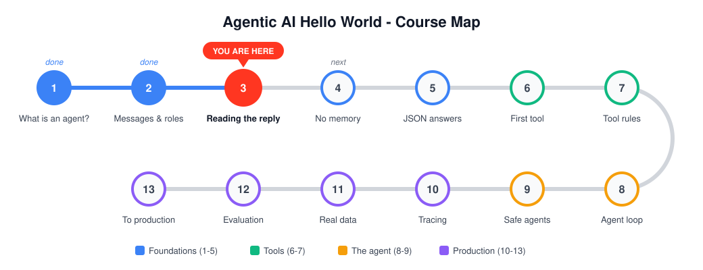
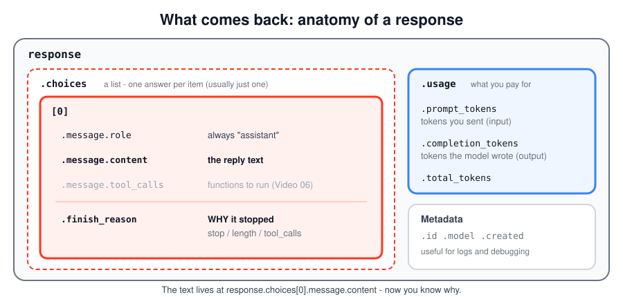

# Video 03 - Reading the reply: choices, finish_reason, tokens and temperature

**Length:** about 10 minutes | **Phase:** Foundations | **Prerequisites:** [Video 02](../02-messages-and-roles/README.md)

## By the end of this video you can
1. Explain every part of a response: `choices`, `message`, `finish_reason`, `usage`.
2. Tell **why** the model stopped (`stop`, `length`, `tool_calls`) and what your code should do about each.
3. Read token counts and use `max_tokens` as a length and cost limit.
4. Use `temperature` to make answers predictable or creative.

## The one idea
> The reply is more than text. **`finish_reason` tells you whether to trust it**, and `usage` tells you what it cost.

## Deliberately NOT in this video
Tool calls in practice (Video 06). Multi-turn memory (Video 04). Structured JSON output (Video 05).

## Files

| File | Use it to |
| --- | --- |
| [notebooks/03-reading-the-reply](notebooks/) | Code along with the video |
| [notebooks/03-reading-the-reply-solutions](notebooks/) | Check your exercise answers (try first!) |
| [script.md](script.md) | Read the narration or use it as a transcript |
| [exercises.md](exercises.md) | Practise after watching (about 15 minutes) |
| [quiz.md](quiz.md) | Check you got it (5 questions) |
| [cheatsheet.md](cheatsheet.md) | Keep open while coding |
| [diagrams/](diagrams/) | The three diagrams from the video |

## Diagrams in this video
1. [Anatomy of a response](diagrams/01-anatomy-of-a-response.svg)
2. [finish_reason](diagrams/02-finish-reason.svg)
3. [The temperature dial](diagrams/03-temperature-dial.svg)

## Recurring segments
* **Cost meter:** output tokens are usually priced higher than input tokens, and `max_tokens` puts a hard ceiling on output - so it is also a **cost cap**. In our test a 100-word paragraph used about 120 output tokens (roughly 3/4 of a word per token).
* **What could go wrong?** A reply cut off by `max_tokens` looks normal if you only read `.content`. In our test, "List 10 tips" with `max_tokens=40` stopped halfway through tip 2 with `finish_reason == "length"`. Code that ignores `finish_reason` ships half answers - and agents that ignore it make decisions on half answers (Video 08).

## Next
[Video 04 - LLMs have no memory](../04-no-memory/README.md)
