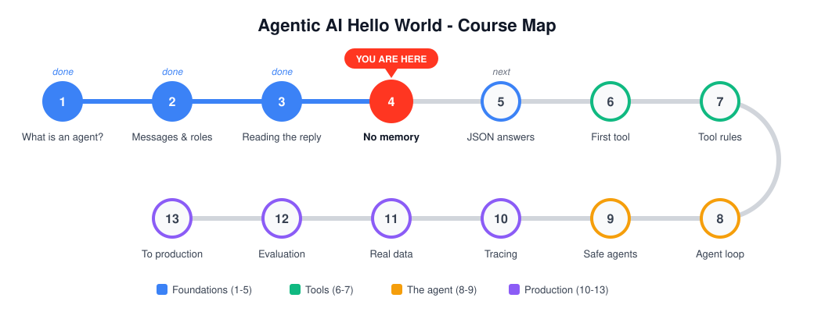
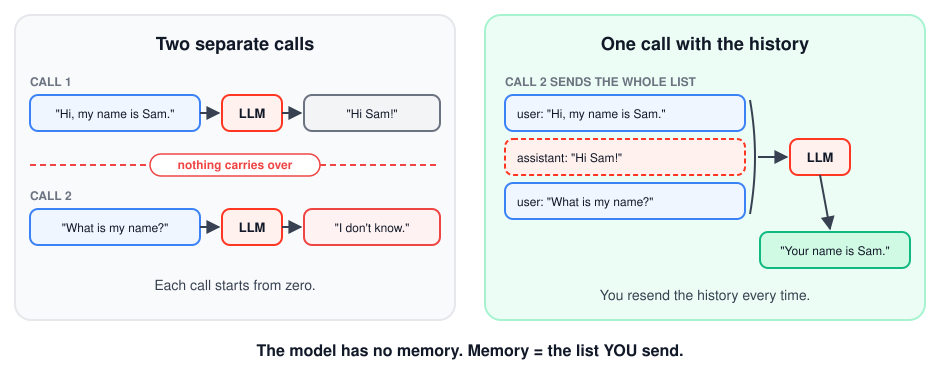

# Video 04 - LLMs have no memory

**Length:** about 10 minutes | **Phase:** Foundations | **Prerequisites:** [Video 03](../03-reading-the-reply/README.md)

## By the end of this video you can
1. Explain why an LLM forgets everything between calls (it is **stateless**).
2. Build a chat that remembers, by keeping the message list yourself.
3. Explain why memory makes every call bigger and more expensive.
4. Trim the history to save tokens - and **pin** important facts so they are not lost.

## The one idea
> The model has no memory. **Memory is the list you send.** Whatever is in the list, the model can "remember"; whatever you leave out is gone.

On the [agent anatomy](../assets/agent-anatomy.svg) picture, today lights up **Memory - the notebook**.

## Deliberately NOT in this video
Long-term memory stores and databases (Part 2). Summarising old history with the LLM (mentioned only). Retrieval (Video 11).

## Files

| File | Use it to |
| --- | --- |
| [notebooks/04-no-memory](notebooks/) | Code along with the video |
| [notebooks/04-no-memory-solutions](notebooks/) | Check your exercise answers (try first!) |
| [script.md](script.md) | Read the narration or use it as a transcript |
| [exercises.md](exercises.md) | Practise after watching (about 15 minutes) |
| [quiz.md](quiz.md) | Check you got it (5 questions) |
| [cheatsheet.md](cheatsheet.md) | Keep open while coding |
| [diagrams/](diagrams/) | The three diagrams from the video |

## Diagrams in this video
1. [Stateless: two calls vs one call with history](diagrams/01-stateless.svg)
2. [Memory is a list that grows](diagrams/02-memory-is-a-list.svg)
3. [Trimming and pinning](diagrams/03-trimming-and-pinning.svg)

## Recurring segments
* **Cost meter:** every call resends the whole history. In our 6-turn test, input tokens grew from 62 on turn 1 to 208 on turn 6 (3.4 times more) - and the **total** for the conversation grows even faster, because you pay for the history again on every turn.
* **What could go wrong?** Trimming old messages saves tokens but can silently drop facts. Keeping only the last 4 messages, the model answered "I don't have that information" when asked the user's name. **Pinning** the key facts in the system prompt fixed it while staying cheap (130 vs 208 input tokens).

## Next
Video 05 - Answers code can use: structured JSON output (coming soon)
