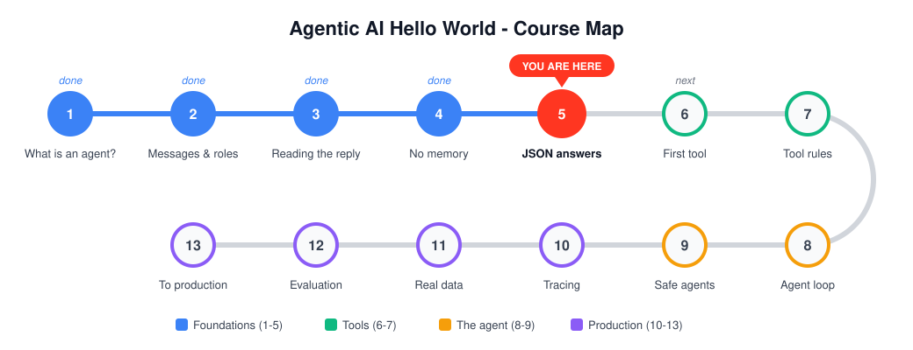
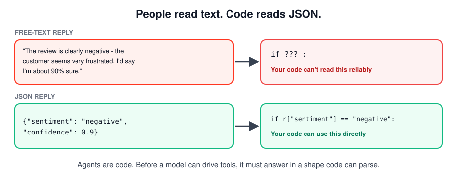

# Video 05 - Answers code can use: structured JSON output



**Length:** about 10 minutes | **Phase:** Foundations (last one!) | **Prerequisites:** [Video 04](../04-no-memory/README.md)

## By the end of this video you can
1. Explain why agents need answers in **JSON**, not free text.
2. Turn a model's JSON reply into a Python `dict` with `json.loads`.
3. Use a **JSON schema** (`response_format`) so the model must return the fields and types you define.
4. Extract structured data from messy text - and **check the values** before trusting them.

## The one idea
> People read text. **Code reads JSON.** A JSON schema makes the model answer in a shape your code can rely on - but your code still has to check the values.



## Deliberately NOT in this video
Tool calling (Video 06) - although you'll see it's just structured output where the structure is "which function, which arguments". Pydantic and validation libraries (mentioned only).

## Files

| File | Use it to |
| --- | --- |
| [notebooks/05-json-answers](notebooks/) | Code along with the video |
| [notebooks/05-json-answers-solutions](notebooks/) | Check your exercise answers (try first!) |
| [script.md](script.md) | Read the narration or use it as a transcript |
| [exercises.md](exercises.md) | Practise after watching (about 15 minutes) |
| [quiz.md](quiz.md) | Check you got it (5 questions) |
| [cheatsheet.md](cheatsheet.md) | Keep open while coding |
| [diagrams/](diagrams/) | The three diagrams from the video |

## Diagrams in this video
1. [People read text, code reads JSON](diagrams/01-text-vs-json.svg)
2. [Three ways to get JSON](diagrams/02-three-ways-to-get-json.svg)
3. [Valid JSON is not correct JSON](diagrams/03-valid-is-not-correct.svg)

## Recurring segments
* **Cost meter:** JSON answers are short. In our test the same sentiment question used **76 output tokens as prose but 16 as JSON** - nearly 5 times cheaper on output.
* **What could go wrong?** Valid JSON can still be wrong. A booking message with no time came back as `"time": "null"` (the *string* "null") from Llama, and `"time": "<UNKNOWN>"` from Claude - even when the schema allowed a real `null`. Both pass `if booking["time"]:`. Fix: a small `clean()` check in code.

## Model differences we found
* Asked politely for JSON, **Claude Haiku wrapped it in a ```` ```json ```` code fence 3 times out of 3**, so `json.loads` failed every time. Llama 3.3, Llama 3.1 8B and GPT OSS 20B returned bare JSON.
* With a **JSON schema**, Llama 3.3, Llama 3.1 8B and Claude Haiku all returned clean, parseable JSON.

## Next
Video 06 - Giving the model hands: your first tool (coming soon)
