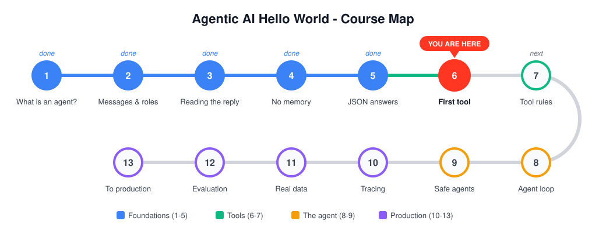
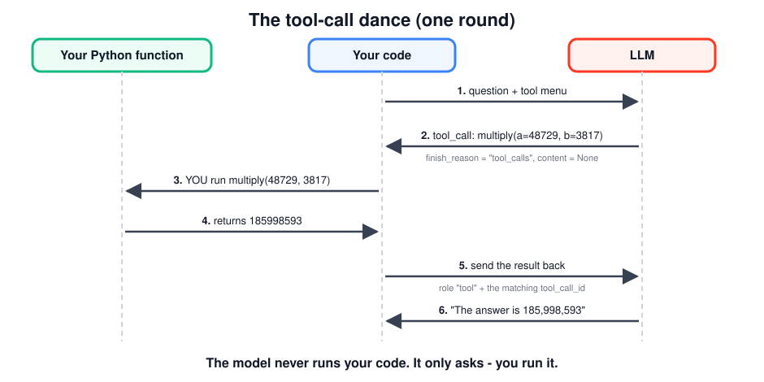

# Video 06 - Giving the model hands: your first tool

**Length:** about 10 minutes | **Phase:** Tools | **Prerequisites:** [Video 05](../05-json-answers/README.md)

## By the end of this video you can
1. Explain that **the model never runs your code** - it asks, and your code runs it.
2. Describe a Python function as a **tool** (name, description, parameters).
3. Do one full round of tool calling **by hand**: question, `tool_call`, run the function, send the result, final answer.
4. Explain why tool **names and descriptions** decide whether the model picks the right tool.

## The one idea
> A tool call is **structured output** (Video 05) where the structure is *which function* and *which arguments*. The model asks; **you** run it; you send the result back.

On the [agent anatomy](../assets/agent-anatomy.svg) picture, today lights up **Tools - the hands**.

## The payoff from Video 01
In Video 01 the model got `48729 * 3817` wrong every time. With a `multiply` tool, both Llama 3.3 and Claude Haiku answered **185,998,593** - exactly right - because Python did the maths.

## Deliberately NOT in this video
The golden rules of tool messages and what breaks when you get them wrong (Video 07). Several tool rounds in a loop - the agent loop (Video 08).

## Files

| File | Use it to |
| --- | --- |
| [notebooks/06-first-tool](notebooks/) | Code along with the video |
| [notebooks/06-first-tool-solutions](notebooks/) | Check your exercise answers (try first!) |
| [script.md](script.md) | Read the narration or use it as a transcript |
| [exercises.md](exercises.md) | Practise after watching (about 15 minutes) |
| [quiz.md](quiz.md) | Check you got it (5 questions) |
| [cheatsheet.md](cheatsheet.md) | Keep open while coding |
| [diagrams/](diagrams/) | The three diagrams from the video |

## Diagrams in this video
1. [The tool-call dance](diagrams/01-the-tool-call-dance.svg)
2. [From a Python function to a tool description](diagrams/02-function-to-schema.svg)
3. [Tool descriptions are the model's only clue](diagrams/03-descriptions-matter.svg)

## Recurring segments
* **Cost meter:** tools are not free. Tool descriptions are sent with **every** call: in our test one small tool raised the input for "Hi" from 36 to 720 tokens on Llama 3.3 (8 to 588 on Claude Haiku). And one tool round needs **two** model calls.
* **What could go wrong?** The model only knows your tools by name and description. With two tools both described as "Does stuff with two numbers", both models picked the wrong one (the adder) 4 times out of 4. The adder returned 52,546; the models noticed it looked wrong and guessed the product in their heads instead - still wrong. With a clear name and description they picked `multiply` every time and got 185,998,593.

## Model differences we found
* Asked about **two cities at once**, Claude Haiku requested both weather lookups in one reply. Llama 3.3 asked for **one city per round** (Perth, then Tokyo) 3 times out of 3 - so code that does exactly one round gets no final answer from Llama. Handling "keep going until there are no more tool calls" is the agent loop (Video 08).

## Next
Video 07 - The golden rules of tools (coming soon)
