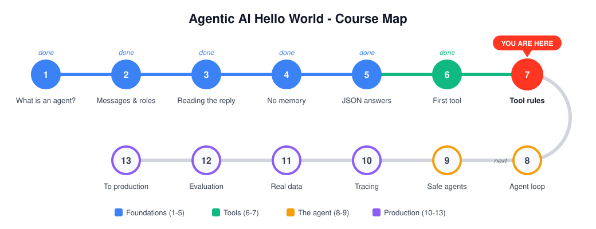
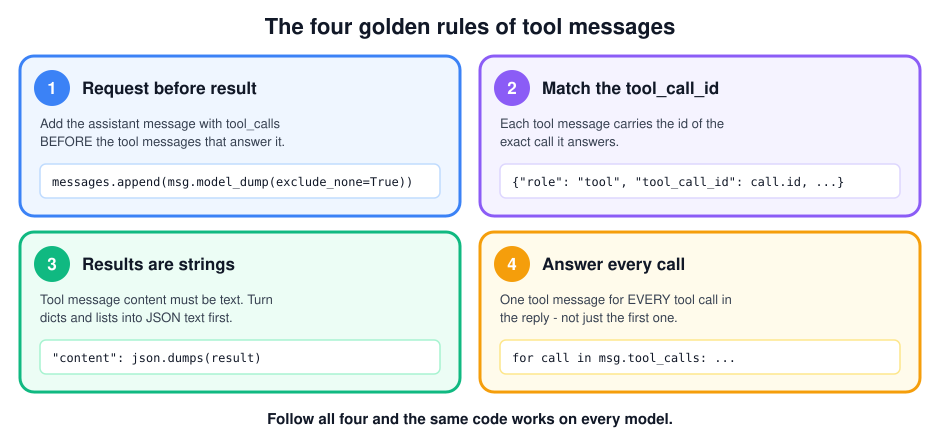

# Video 07 - The golden rules of tools

**Length:** about 10 minutes | **Phase:** Tools | **Prerequisites:** [Video 06](../06-first-tool/README.md)

## By the end of this video you can
1. Follow the **four golden rules** of tool messages - and know what breaks when you don't.
2. Explain why code that works on one model can **crash on another**.
3. Write one small helper that adds tool results correctly, every time.
4. Practise **context engineering**: design tools that give the model only what it needs.

## The one idea
> Tool messages have strict rules - some models enforce them, some quietly don't. **Write to the strictest rules.** And what you put in the context window decides cost *and* correctness.

## The four golden rules
1. **Request before result** - add the assistant message with `tool_calls` before its `tool` messages.
2. **Match the `tool_call_id`** - each `tool` message carries the id of the call it answers.
3. **Results are strings** - `json.dumps()` dicts and lists.
4. **Answer every call** - one `tool` message per tool call in the reply.

## Deliberately NOT in this video
The agent loop (Video 08). Tool errors and retries (Video 09). Real data tools (Video 11).

## Files

| File | Use it to |
| --- | --- |
| [notebooks/07-tool-rules](notebooks/) | Code along with the video |
| [notebooks/07-tool-rules-solutions](notebooks/) | Check your exercise answers (try first!) |
| [script.md](script.md) | Read the narration or use it as a transcript |
| [exercises.md](exercises.md) | Practise after watching (about 15 minutes) |
| [quiz.md](quiz.md) | Check you got it (5 questions) |
| [cheatsheet.md](cheatsheet.md) | Keep open while coding |
| [diagrams/](diagrams/) | The three diagrams from the video |

## Diagrams in this video
1. [The four golden rules](diagrams/01-four-golden-rules.svg)
2. [Break a rule on purpose: what happens?](diagrams/02-strict-vs-lenient.svg)
3. [Context engineering: what goes into the window](diagrams/03-context-budget.svg)

## Recurring segments
* **What could go wrong?** Lenient models hide bugs. In our tests Llama 3.3 **silently accepted** a missing assistant request (rule 1) and a wrong `tool_call_id` (rule 2), while Claude Haiku rejected both with an error. Both rejected a dict as content (rule 3), and Claude rejected answering only 1 of 2 calls (rule 4). Code tested only on Llama would crash the day you switch models.
* **Cost meter:** a tool that dumps all 400 orders sent **31,019** input tokens; a narrow tool that returns one total sent **824** - about 38 times fewer. And the big dump was not just expensive - it was unreliable. The true total is **$2,223.40**. Over two runs, Llama answered $781.45 and $872.28 (both wrong); Claude was right once and wrong once ($2,623.37). The narrow tool was right on both models every time.

## Model differences we found
* The Databricks Llama 3.3 endpoint returns **only one tool call per reply** (sending it a reply with two calls gives "Multiple tool calls are not supported"). That's why Llama asked for Perth, then Tokyo, in Video 06. Claude can ask for several at once.

## Next
Video 08 - The agent loop (coming soon)
