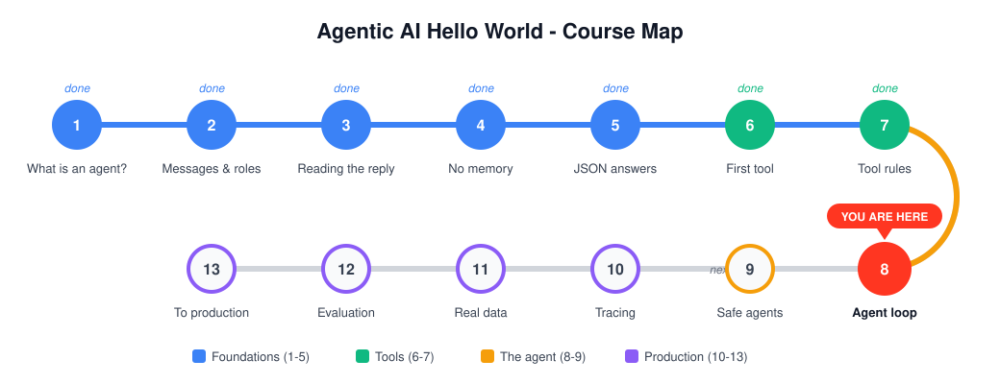
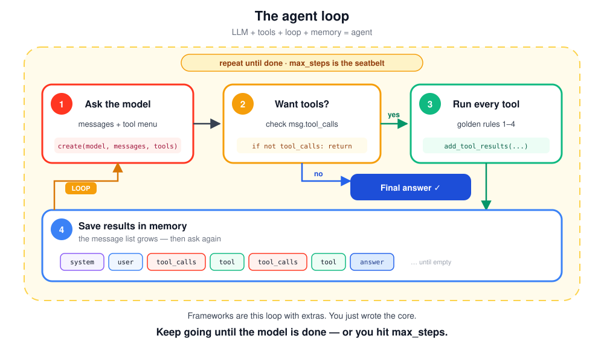

# Video 08 - The agent loop

**Length:** about 10 minutes | **Phase:** The agent | **Prerequisites:** [Video 07](../07-tool-rules/README.md)

## By the end of this video you can
1. Explain that an **agent** is just an LLM + tools + a loop + memory.
2. Write a ~40-line agent that **keeps going** until the model is done.
3. Chain several tools to answer **one** question.
4. Explain why a **step limit** belongs in the loop from day one.

## The one idea
> One tool round is not enough. Put Videos 06-07 in a loop: ask the model, run tools, ask again - until it answers. **That loop is an agent.**

On the [agent anatomy](../assets/agent-anatomy.svg) picture, today lights up **the LOOP**.

## Why this video exists
In Video 06, Llama asked for Perth's weather, then Tokyo's - one city per reply. One hand-written round left you with another tool call, not an answer. The fix is not more clever prompting. It is a loop.

## Deliberately NOT in this video
Guardrails beyond a step limit, error retries, human approval (Video 09). MLflow tracing (Video 10). Frameworks (Video 13).

## Files

| File | Use it to |
| --- | --- |
| [notebooks/08-agent-loop](notebooks/) | Code along with the video |
| [notebooks/08-agent-loop-solutions](notebooks/) | Check your exercise answers (try first!) |
| [script.md](script.md) | Read the narration or use it as a transcript |
| [exercises.md](exercises.md) | Practise after watching (about 15 minutes) |
| [quiz.md](quiz.md) | Check you got it (5 questions) |
| [cheatsheet.md](cheatsheet.md) | Keep open while coding |
| [diagrams/](diagrams/) | The three diagrams from the video |

## Diagrams in this video
1. [The agent loop](diagrams/01-the-agent-loop.svg)
2. [One round vs a loop](diagrams/02-one-round-vs-loop.svg)
3. [Design choices in the loop](diagrams/03-design-choices.svg)

## Recurring segments
* **What could go wrong?** Without a step limit, a confused model can request tools forever - and every step costs tokens. Set `max_steps=1` on a multi-tool question and watch it stop mid-job. The step limit is your first **guardrail** (Video 09 builds the rest).
* **Cost meter:** each loop iteration is one model call. "What's 15% of customer 42's order?" typically needs **3 calls** (look up total → calculator → final answer). Multiply by tokens and price: agents are not free, and longer chains cost more.

## Model differences we found
* Claude Haiku often batches parallel tool calls in one reply (e.g. both cities at once). Llama 3.3 on Databricks returns **one tool call per reply**, so the same question needs more loop iterations. The loop hides that difference: keep going until there are no more tool calls.

## Next
Video 09 - Keeping agents safe (coming soon)
