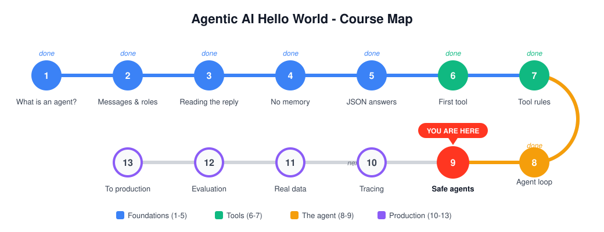
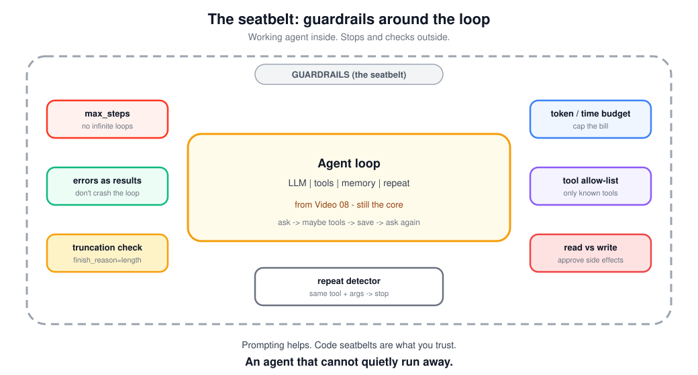

# Video 09 - Keeping agents safe

**Length:** about 11 minutes | **Phase:** The agent | **Prerequisites:** [Video 08](../08-agent-loop/README.md)

## By the end of this video you can
1. Name the **seatbelts** that keep an agent from running away.
2. Turn tool failures into **results the model can read**, not crashes.
3. Stop on **truncated replies**, **repeated tool calls**, and **budget caps**.
4. Separate **read** tools from **write** tools (human approval as a pattern).

## The one idea
> A working loop is not enough. Without guardrails, a confused model can burn tokens, loop forever, or call the wrong tool. **Wrap the agent in seatbelts.**

On the [agent anatomy](../assets/agent-anatomy.svg) picture, today lights up **Guardrails - the seatbelt**.

## Why this video exists
Video 08 gave you `max_steps`. That stops infinite loops - but not crashes inside a tool, not a reply cut off by `max_tokens`, not the same tool call repeated five times, and not a write tool firing when you only meant to read.

## Deliberately NOT in this video
MLflow tracing (Video 10). Real Unity Catalog data (Video 11). Full content-safety filters and production gateways (Video 13 / Part 2).

## Files

| File | Use it to |
| --- | --- |
| [notebooks/09-safe-agents](notebooks/) | Code along with the video |
| [notebooks/09-safe-agents-solutions](notebooks/) | Check your exercise answers (try first!) |
| [script.md](script.md) | Read the narration or use it as a transcript |
| [exercises.md](exercises.md) | Practise after watching (about 15 minutes) |
| [quiz.md](quiz.md) | Check you got it (5 questions) |
| [cheatsheet.md](cheatsheet.md) | Keep open while coding |
| [diagrams/](diagrams/) | The three diagrams from the video |

## Diagrams in this video
1. [The seatbelt: guardrails around the loop](diagrams/01-the-seatbelt.svg)
2. [Errors as results, not crashes](diagrams/02-errors-as-results.svg)
3. [Caps that stop a runaway agent](diagrams/03-stop-conditions.svg)

## Recurring segments
* **What could go wrong?** A tool that raises, or a write tool the model invents a reason to call. Without try/except the whole agent dies mid-loop. Without an allow-list, "unknown tool" is only a string if you remember to check - otherwise you crash or run something you never intended.
* **Cost meter:** every failed step still costs a model call. A budget cap (`max_tokens_total`) stops a confused agent before the bill grows. In our demo, a sticky retry without a repeat-detector burned **5 model calls**; with the detector it stopped after **2**.

## Model differences we found
* Truncation (`finish_reason == "length"`) is rare at high `max_tokens`, but easy to demo with a tiny cap. Treat it as "not done" - never trust a cut-off reply as the final answer.
* Retries after a 429/timeout are the same idea on every model: wait, try again, give up after N attempts. Don't retry forever.

## Next
Video 10 - Seeing inside the agent (coming soon)
