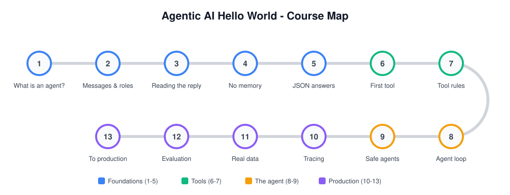

# Agentic AI Hello World - Video Series

A bite-sized video series that takes you from **zero agentic AI knowledge** to building, tracing, evaluating and deploying your own AI agent on Databricks - in plain Python, one idea at a time.



## Who this is for
* You can write basic Python (variables, functions, lists, dicts, loops).
* You have **never** built anything with an LLM or an agent.
* You have access to a Databricks workspace.

## How the series works
* **13 short videos, 8-12 minutes each.** One idea per video.
* **Every video ends with something working.** No theory-only episodes.
* **No frameworks until the last video.** You write the agent yourself first, so frameworks stop being magic.
* **Two recurring segments in every video:**
  * **Cost meter** (about 30 s) - how many tokens did that cost, and what does that mean in dollars?
  * **What could go wrong?** (about 1 min) - one failure mode and how to spot or fix it.

## Start here
1. Read [setup.md](setup.md) and check your workspace is ready (5 minutes).
2. Open [course-map.md](course-map.md) to see the whole journey.
3. Begin with [Video 01 - What is an AI agent?](01-what-is-an-agent/README.md).
4. Keep [glossary.md](glossary.md) open - it grows with every video.

## Folder layout
```
videos/
  README.md                 <- you are reading this
  course-map.md             <- all 13 videos, topic coverage, what is deliberately left out
  glossary.md               <- every term, and the video that introduces it
  setup.md                  <- workspace, compute and model checklist
  assets/                   <- shared diagrams reused across videos
    you-are-here-template.svg
    agent-anatomy.svg
  01-what-is-an-agent/      <- one folder per video
  02-.../
```

Every video folder has the same shape:

| File | What it is for |
| --- | --- |
| `README.md` | Goals, prerequisites, files, time needed. Start here for each video. |
| `script.md` | The narration with timestamps and on-screen cues (also usable as a transcript). |
| `you-are-here.svg` | The course map with this video highlighted. |
| `diagrams/` | The SVG diagrams shown in the video. |
| `notebooks/` | The learner notebook and a separate solutions notebook. |
| `exercises.md` | Practice tasks, each starting with "predict first". |
| `quiz.md` | 5 check-yourself questions with answers. |
| `cheatsheet.md` | One page to keep open while coding. |

## Status

| Video | Status |
| --- | --- |
| 01 [What is an AI agent? + your first LLM call](01-what-is-an-agent/README.md) | Ready |
| 02 [Talking to the model: messages and roles](02-messages-and-roles/README.md) | Ready |
| 03-13 | Planned (see [course-map.md](course-map.md)) |
