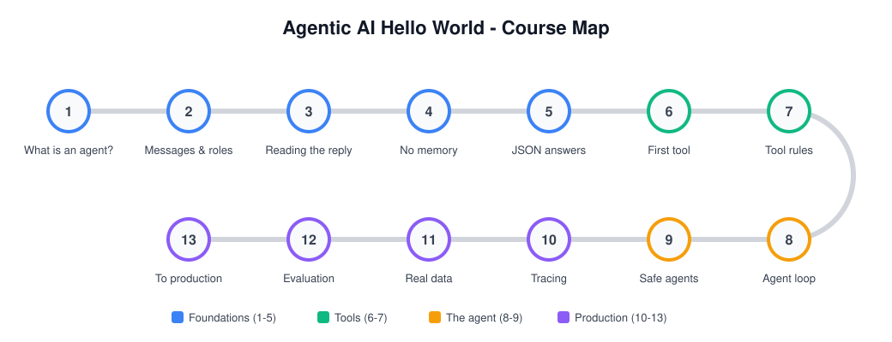
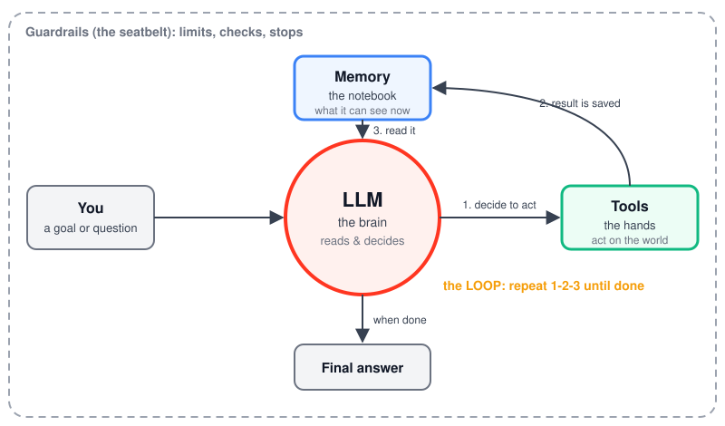

# Course Map

## The running picture: anatomy of an agent
Every video opens with this picture and lights up the part it adds. By Video 08 every part is lit.

| Part | Metaphor | Built in |
| --- | --- | --- |
| LLM | Brain - reads and decides | 01-03 |
| Memory | Notebook - what the brain can see right now | 04 |
| Tools | Hands - act on the world | 06-07 |
| Loop | Persistence - keep going until the job is done | 08 |
| Guardrails | Seatbelt - limits, checks and stops | 09 |

## The 13 videos

| # | Video | The one idea | You leave with |
| --- | --- | --- | --- |
| 01 | What is an AI agent? + your first LLM call | An LLM is text in, text out | A notebook that talks to an LLM |
| 02 | Talking to the model: messages and roles | system, user, assistant | A model with a personality you designed |
| 03 | Reading the reply | `choices`, `finish_reason`, tokens, temperature | You can read every field of a response |
| 04 | LLMs have no memory | Memory is a list you manage | A chat that remembers - and a trimmed history |
| 05 | Answers code can use | Structured JSON output | A model that returns a Python dict |
| 06 | Giving the model hands | Your first tool call, done by hand | A model that uses your Python function |
| 07 | The golden rules of tools | Message order, ids, strings + context engineering | Tool code that works on any model |
| 08 | The agent loop | LLM + tools + loop = agent | **Your first real agent** (about 40 lines) |
| 09 | Keeping agents safe | Step limits, guardrails, errors, retries | An agent that cannot run away |
| 10 | Seeing inside the agent | MLflow tracing | A trace you can debug from |
| 11 | Agents on real data | Unity Catalog tools + retrieval | An agent that answers from your data |
| 12 | Is my agent any good? | Evaluation basics | A 10-question test suite with scores |
| 13 | From script to product | Frameworks, deployment, what's next | A deployed agent endpoint |

## Phases

| Phase | Videos | Question it answers |
| --- | --- | --- |
| Foundations | 01-05 | How do I talk to an LLM and get useful answers? |
| Tools | 06-07 | How does an LLM make my code do things? |
| The agent | 08-09 | How do I turn that into a safe, working agent? |
| Production | 10-13 | How do I see, test and ship it? |

## Big topics and where they are covered
Nine topics every agent builder eventually needs. This series covers what a beginner needs to understand and safely run **one** agent; the rest is deliberately saved for Part 2.

| Topic | Coverage | Where |
| --- | --- | --- |
| Termination logic | Core | 08 (stop when no tool calls), 09 (step limit, truncated replies, repeated calls, time and cost caps) |
| Guardrails | Beginner level | 09 (read-only tools, input validation, tool allow-lists, caps, human approval as a pattern); 13 mentions content-safety filters |
| Cost of tokens | Every video | Cost meter segment; 03 (what tokens are), 04 (memory makes calls pricier), 08 (calls per question), 10 (token totals in traces) |
| Agent loop and planning | Loop core, planning light | 08 (the loop), 09 ("think, then act" prompting) |
| Context engineering, memory, retrieval | Partial | 04 (short-term memory, trimming), 07 (what goes into the context window), 11 (retrieval as a tool) |
| Tool use and action design | Core | 06-07 (tool calling, golden rules), 09 and 11 (narrow tools, read vs write, safe retries, errors as results, good descriptions) |
| Orchestration and multi-agent patterns | Preview only | 13 (one diagram: router, supervisor, hand-off - no code) |
| Evaluation and observability | Core | 10 (tracing), 12 (evaluation) |
| Backend and systems engineering | Beginner level | 09 (retries, timeouts, rate limits), 13 (deploy as an endpoint) |

## Deliberately left out: Part 2 - Production agents
These matter, but they only make sense once you have built one agent yourself.
* Multi-agent orchestration (supervisors, routers, hand-offs)
* Planner/executor and reflection patterns
* Long-term memory stores
* Advanced guardrails with Unity Gateway
* Async execution and storing agent state
* Scaling, rate limits and load testing
* Cost optimisation: caching and routing to smaller models
